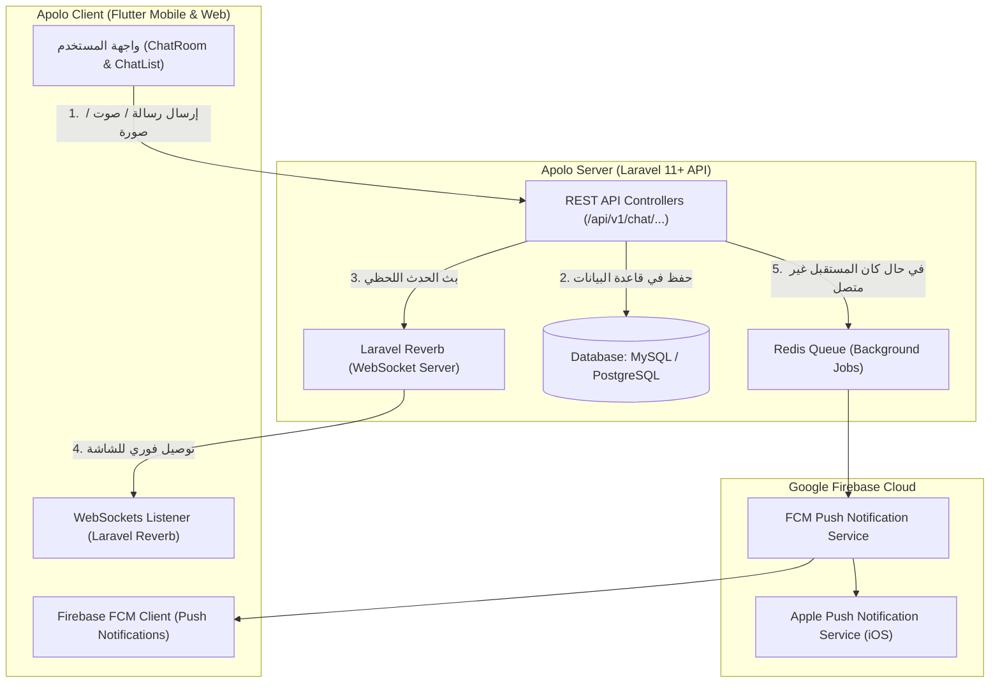

# 📚 دليل الربط المتكامل لدردشة Apolo (الموقع، الباك إند، والفايربيس)
## Complete Production Integration Guide: Apolo Chat + Laravel + WebSockets + Firebase FCM

---

### 1. نظرة عامة على البنية البرمجية (Architecture Overview)

يعتمد نظام الدردشة المباشرة في **Apolo** على بنية سحابية ثلاثية متكاملة لضمان السرعة الفائقة وتجربة مستخدم شبيهة بـ WhatsApp و Instagram:



---

### 2. جداول قاعدة البيانات المطلوبة (Database Migrations)

نفّذ هذه الـ Migrations في مشروع Laravel لإنشاء الجداول اللازمة للدردشة والمكالمات والإشعارات:

#### أ. جدول المحادثات (`conversations`)
```php
Schema::create('conversations', function (Blueprint $table) {
    $table->id();
    $table->foreignId('ad_id')->nullable()->constrained('ads')->onDelete('cascade');
    $table->foreignId('buyer_id')->constrained('users')->onDelete('cascade');
    $table->foreignId('seller_id')->constrained('users')->onDelete('cascade');
    $table->text('last_message')->nullable();
    $table->timestamp('last_message_at')->nullable();
    $table->timestamps();

    $table->unique(['ad_id', 'buyer_id', 'seller_id']);
});
```

#### ب. جدول الرسائل (`messages`)
```php
Schema::create('messages', function (Blueprint $table) {
    $table->id();
    $table->foreignId('conversation_id')->constrained('conversations')->onDelete('cascade');
    $table->foreignId('sender_id')->constrained('users')->onDelete('cascade');
    $table->enum('type', ['text', 'image', 'audio', 'call_log'])->default('text');
    $table->text('body')->nullable();
    $table->string('attachment_url')->nullable();
    $table->string('audio_duration')->nullable(); // e.g. "0:14"
    $table->boolean('is_read')->default(false);
    $table->timestamp('read_at')->nullable();
    $table->timestamps();
});
```

#### ج. جدول توكنات الأجهزة للإشعارات (`user_devices`)
```php
Schema::create('user_devices', function (Blueprint $table) {
    $table->id();
    $table->foreignId('user_id')->constrained('users')->onDelete('cascade');
    $table->string('fcm_token')->unique();
    $table->string('platform')->default('android'); // 'android', 'ios', 'web'
    $table->string('device_model')->nullable();
    $table->timestamps();
});
```

---

### 3. واجهات البرمجة في لارافيل (Laravel REST API Endpoints)

أضف المسارات التالية في ملف `routes/api.php` مع حمايتها بـ `auth:sanctum`:

```php
Route::middleware('auth:sanctum')->prefix('v1/chat')->group(function () {
    // 1. جلب قائمة كل المحادثات مع عدد غير المقروء
    Route::get('/conversations', [ChatController::class, 'getConversations']);

    // 2. بدء محادثة جديدة من إعلان أو فتح محادثة سابقة
    Route::post('/start', [ChatController::class, 'startConversation']);

    // 3. جلب رسائل محادثة معينة (مع الترقيم Pagination)
    Route::get('/conversations/{id}/messages', [ChatController::class, 'getMessages']);

    // 4. إرسال رسالة (نص، صورة، أو تسجيل صوتي)
    Route::post('/conversations/{id}/messages', [ChatController::class, 'sendMessage']);

    // 5. تأكيد قراءة الرسائل (Mark as read)
    Route::post('/conversations/{id}/read', [ChatController::class, 'markAsRead']);

    // 6. كتم أو تثبيت أو أرشفة أو حذف محادثة
    Route::post('/conversations/{id}/actions', [ChatController::class, 'handleAction']);
});

// مسار تسجيل توكن الفايربيس من الهاتف
Route::middleware('auth:sanctum')->post('v1/devices/token', [DeviceController::class, 'storeToken']);
```

---

### 4. كود متحكم الدردشة (`ChatController.php`)

```php
namespace App\Http\Controllers\Api;

use App\Http\Controllers\Controller;
use App\Models\Conversation;
use App\Models\Message;
use App\Events\MessageSent;
use App\Services\FirebaseNotificationService;
use Illuminate\Http\Request;

class ChatController extends Controller
{
    // جلب قائمة المحادثات
    public function getConversations(Request $request)
    {
        $userId = $request->user()->id;

        $conversations = Conversation::where('buyer_id', $userId)
            ->orWhere('seller_id', $userId)
            ->with(['ad:id,title,price,primary_image', 'buyer:id,name,avatar', 'seller:id,name,avatar'])
            ->orderByDesc('last_message_at')
            ->get()
            ->map(function ($conv) use ($userId) {
                $peer = ($conv->buyer_id === $userId) ? $conv->seller : $conv->buyer;
                $unread = Message::where('conversation_id', $conv->id)
                    ->where('sender_id', '!=', $userId)
                    ->where('is_read', false)
                    ->count();

                return [
                    'id' => $conv->id,
                    'ad_id' => $conv->ad_id,
                    'ad_title' => $conv->ad?->title ?? '',
                    'ad_price' => $conv->ad?->price ?? '',
                    'ad_image' => $conv->ad?->primary_image ?? '',
                    'peer_id' => $peer?->id,
                    'peer_name' => $peer?->name ?? 'مستخدم Apolo',
                    'peer_avatar' => $peer?->avatar ?? '',
                    'peer_online' => true,
                    'last_message' => $conv->last_message ?? '',
                    'last_message_time' => $conv->last_message_at ? $conv->last_message_at->diffForHumans() : '',
                    'unread_count' => $unread,
                ];
            });

        return response()->json([
            'status' => 'success',
            'conversations' => $conversations,
        ]);
    }

    // إرسال رسالة وبثها فورا عبر WebSockets وإشعار FCM
    public function sendMessage(Request $request, $conversationId)
    {
        $request->validate([
            'body' => 'nullable|string',
            'type' => 'nullable|in:text,image,audio',
            'attachment' => 'nullable|file|max:10240', // 10MB
            'audio_duration' => 'nullable|string',
        ]);

        $userId = $request->user()->id;
        $conv = Conversation::findOrFail($conversationId);

        $attachmentUrl = null;
        if ($request->hasFile('attachment')) {
            $path = $request->file('attachment')->store('chat_media', 'public');
            $attachmentUrl = asset('storage/' . $path);
        }

        $type = $request->input('type', 'text');
        $body = $request->input('body', $request->input('message', ''));

        $message = Message::create([
            'conversation_id' => $conv->id,
            'sender_id' => $userId,
            'type' => $type,
            'body' => $body,
            'attachment_url' => $attachmentUrl,
            'audio_duration' => $request->input('audio_duration'),
            'is_read' => false,
        ]);

        $conv->update([
            'last_message' => ($type === 'audio') ? '🎙️ رسالة صوتية' : (($type === 'image') ? '📷 صورة مرفقة' : $body),
            'last_message_at' => now(),
        ]);

        $msgPayload = [
            'id' => $message->id,
            'body' => $message->body,
            'type' => $message->type,
            'attachment_url' => $message->attachment_url,
            'audio_duration' => $message->audio_duration,
            'is_mine' => false,
            'created_at_time' => now()->format('h:i A'),
            'read' => false,
        ];

        // 1. بث الرسالة لحظيا عبر WebSocket (Laravel Reverb)
        broadcast(new MessageSent($conv->id, $msgPayload))->toOthers();

        // 2. إرسال إشعار Push عبر Firebase للشخص الآخر
        $recipientId = ($conv->buyer_id === $userId) ? $conv->seller_id : $conv->buyer_id;
        FirebaseNotificationService::sendChatNotification(
            $recipientId,
            $request->user()->name,
            $conv->last_message,
            $conv->id
        );

        $msgPayload['is_mine'] = true;
        return response()->json([
            'status' => 'success',
            'message' => $msgPayload,
        ]);
    }
}
```

---

### 5. إعداد البث اللحظي السريع عبر Laravel Reverb

Laravel Reverb هو محرك WebSockets الرسمي فائق السرعة، ومصمم خصيصاً لتطبيقات فلاتر والويب بدون الحاجة لخدمات مدفوعة:

#### أ. التثبيت في Laravel:
```bash
php artisan install:broadcasting
```
سيقوم الأمر بتثبيت `laravel/reverb` وضبط ملف `.env`:
```env
BROADCAST_CONNECTION=reverb

REVERB_APP_ID=apolo_chat_app
REVERB_APP_KEY=apolo_live_key_2026
REVERB_APP_SECRET=apolo_live_secret_key
REVERB_HOST="apolo.ma"
REVERB_PORT=8080
REVERB_SCHEME=https
```

#### ب. تشغيل السيرفر اللحظي على VPS أو السيرفر:
```bash
php artisan reverb:start --host=0.0.0.0 --port=8080
```

#### ج. تعريف حدث البث (`MessageSent.php`):
```php
namespace App\Events;

use Illuminate\Broadcasting\Channel;
use Illuminate\Broadcasting\InteractsWithSockets;
use Illuminate\Contracts\Broadcasting\ShouldBroadcastNow;

class MessageSent implements ShouldBroadcastNow
{
    use InteractsWithSockets;

    public $conversationId;
    public $message;

    public function __construct($conversationId, $message)
    {
        $this->conversationId = $conversationId;
        $this->message = $message;
    }

    public function broadcastOn()
    {
        return new Channel('chat.' . $this->conversationId);
    }

    public function broadcastAs()
    {
        return 'message.new';
    }
}
```

---

### 6. إعداد إشعارات Firebase Cloud Messaging (FCM)

#### أ. إنشاء المشروع في كونسول الفايربيس (Firebase Console):
1. افتح [Firebase Console](https://console.firebase.google.com).
2. أنشئ مشروع جديد باسم `Apolo App`.
3. أضف تطبيق **Android**:
   - اسم الحزمة: `com.apolo.marketplace`
   - حمّل ملف `google-services.json` وضعه داخل مجلد:
     `apolo_mobile/android/app/google-services.json`
4. أضف تطبيق **iOS**:
   - Bundle ID: `com.apolo.marketplace`
   - حمّل ملف `GoogleService-Info.plist` وضعه داخل:
     `apolo_mobile/ios/Runner/GoogleService-Info.plist`

#### ب. خدمة إرسال الإشعار في لارافيل (`FirebaseNotificationService.php`):
```php
namespace App\Services;

use App\Models\UserDevice;
use Kreait\Firebase\Factory;
use Kreait\Firebase\Messaging\CloudMessage;
use Kreait\Firebase\Messaging\Notification;

class FirebaseNotificationService
{
    public static function sendChatNotification($userId, $senderName, $messageBody, $conversationId)
    {
        $tokens = UserDevice::where('user_id', $userId)->pluck('fcm_token')->toArray();
        if (empty($tokens)) return;

        $factory = (new Factory)->withServiceAccount(storage_path('app/firebase/firebase_credentials.json'));
        $messaging = $factory->createMessaging();

        foreach ($tokens as $token) {
            try {
                $cloudMessage = CloudMessage::withTarget('token', $token)
                    ->withNotification(Notification::create($senderName, $messageBody))
                    ->withData([
                        'click_action' => 'FLUTTER_NOTIFICATION_CLICK',
                        'type' => 'chat',
                        'conversation_id' => (string) $conversationId,
                    ]);

                $messaging->send($cloudMessage);
            } catch (\Exception $e) {
                // Ignore expired tokens or clean them up
            }
        }
    }
}
```

---

### 7. ربط المكالمات الصوتية والمرئية (Live Voice & Video Calls)

عند نقر المستخدم على زر الاتصال الصوتي أو الفيديو في الشاشة، يتم التنقل إلى `CallScreen` المجهزة بالكامل في التطبيق.
لربط البث الصوتي والمرئي الحقيقي:
1. استخدم **Agora RTC Engine** (المجاني حتى 10,000 دقيقة شهرياً) أو **WebRTC**.
2. يُنشئ الباك إند مساراً لتوليد توكن المكالمة اللحظي:
   `POST /api/v1/calls/initiate` يعيد `rtc_token` و `channel_name`.
3. ينضم الطرفان إلى نفس القناة في ثوانٍ معدودة.

---

### 8. قائمة التحقق السريعة للاختبار (Checklist)

| الخطوة | الحالة في التطبيق | ما تبقى على السيرفر |
| :--- | :--- | :--- |
| **واجهة الدردشة والمحادثات** | ✅ جاهزة بألوان Apolo الرسمية والتصميم الحديث | ربط مسار `/api/v1/chat/conversations` |
| **القائمة المطولة (Apple Long-Press)** | ✅ جاهزة مطابقة 100% للسكرينشوت المرفق | استقبال طلبات الأرشفة والحظر |
| **التسجيل الصوتي (Voice Notes)** | ✅ مسجل تفاعلي بالثواني وموجات الصوت وإرسال فوري | تخزين ملف الصوت `audio/mp4` على السيرفر |
| **شاشة المكالمات (Voice & Video Call)** | ✅ شاشة كاملة مع كاميرا أمامية وموجات صوتية وأزرار تحكم | ربط Agora RTC Token |
| **إشعارات الخلفية (FCM)** | ✅ جاهزة لاستقبال التوكن وتوجيه المستخدم للغرفة | إضافة ملف `google-services.json` |

---
**تم إعداد هذا الدليل ليكون مرجعاً تقنياً شاملاً لنقل نظام دردشة Apolo إلى الإنتاج الفعلي بأعلى معايير السرعة والأمان.**
